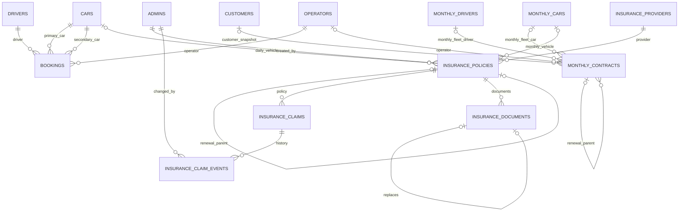

# Legacy-to-Laravel database mapping

Source snapshot: `fleet-beta-28-10-2026.sql` (2026-10-28). This field map is identity-preserving: destination field and storage type retain the source name/type unless a reviewed transformation is documented. The current Laravel database does not yet have these domain tables, and was not modified. Before creating them, compare this dump to a fresh destination schema inspection. No import is authorized by this mapping.

## Mapping convention

- Every source column in each `CREATE TABLE` block is listed below, including nullable/default constraints and types.
- Planned compatibility destination is the same `table.column` with the same MySQL type, unsignedness, nullability, and default. This is a mapping target, not a claim that a Laravel model/table has already been created.
- Integers, dates, enums and text remain unchanged; date strings must be validated as `Y-m-d`; ENUM values must be allow-listed; decimal values must be validated as decimal strings and stored as DECIMAL (never converted through float).
- Generated IDs and timestamps retain the original values during migration. Password hashes stay in `admins.password_hash` and are never exposed in mapping reports or API resources.
- For nullable legacy foreign keys, preserve NULL. Do not replace missing historical references with guessed IDs.

## Field-by-field mapping

### `admins`

| Source field | Source type | Nullable | Source default | Planned destination field / type | Transform and validation |
|---|---|---:|---|---|---|
| `admins.id` | `int(10) UNSIGNED` | No | `—` | `admins.id` / `int(10) UNSIGNED` | Preserve source value; validate against source nullability/default. |
| `admins.username` | `varchar(80)` | No | `—` | `admins.username` / `varchar(80)` | Preserve source value; validate against source nullability/default. |
| `admins.email` | `varchar(150)` | Yes | `NULL` | `admins.email` / `varchar(150)` | Preserve source value; validate against source nullability/default. |
| `admins.password_hash` | `varchar(255)` | No | `—` | `admins.password_hash` / `varchar(255)` | Sensitive hash: migrate only with explicit account mapping; never return or report value. |
| `admins.is_active` | `tinyint(1)` | No | `1` | `admins.is_active` / `tinyint(1)` | Preserve source value; validate against source nullability/default. |
| `admins.last_login_at` | `datetime` | Yes | `NULL` | `admins.last_login_at` / `datetime` | Validate date/datetime format; preserve calendar value and source nullability. |
| `admins.created_at` | `timestamp` | No | `current_timestamp()` | `admins.created_at` / `timestamp` | Preserve source value; validate against source nullability/default. |
| `admins.updated_at` | `timestamp` | No | `current_timestamp()` | `admins.updated_at` / `timestamp` | Preserve source value; validate against source nullability/default. |

### `bookings`

| Source field | Source type | Nullable | Source default | Planned destination field / type | Transform and validation |
|---|---|---:|---|---|---|
| `bookings.id` | `int(10) UNSIGNED` | No | `—` | `bookings.id` / `int(10) UNSIGNED` | Preserve source value; validate against source nullability/default. |
| `bookings.guest_company_name` | `varchar(255)` | No | `—` | `bookings.guest_company_name` / `varchar(255)` | Preserve source value; validate against source nullability/default. |
| `bookings.car_id` | `int(10) UNSIGNED` | Yes | `NULL` | `bookings.car_id` / `int(10) UNSIGNED` | Preserve integer key; validate reference against the named FK target; NULL only where source permits. |
| `bookings.custom_car_name` | `varchar(255)` | Yes | `NULL` | `bookings.custom_car_name` / `varchar(255)` | Preserve source value; validate against source nullability/default. |
| `bookings.secondary_car_id` | `int(10) UNSIGNED` | Yes | `NULL` | `bookings.secondary_car_id` / `int(10) UNSIGNED` | Preserve integer key; validate reference against the named FK target; NULL only where source permits. |
| `bookings.driver_id` | `int(10) UNSIGNED` | Yes | `NULL` | `bookings.driver_id` / `int(10) UNSIGNED` | Preserve integer key; validate reference against the named FK target; NULL only where source permits. |
| `bookings.custom_driver_name` | `varchar(255)` | Yes | `NULL` | `bookings.custom_driver_name` / `varchar(255)` | Preserve source value; validate against source nullability/default. |
| `bookings.operator_id` | `int(10) UNSIGNED` | Yes | `NULL` | `bookings.operator_id` / `int(10) UNSIGNED` | Preserve integer key; validate reference against the named FK target; NULL only where source permits. |
| `bookings.operator_name` | `varchar(150)` | No | `—` | `bookings.operator_name` / `varchar(150)` | Preserve source value; validate against source nullability/default. |
| `bookings.even_odd` | `enum('Even','Odd')` | Yes | `NULL` | `bookings.even_odd` / `enum('Even','Odd')` | Accept only listed legacy enum values; preserve exact spelling. |
| `bookings.start_date` | `date` | No | `—` | `bookings.start_date` / `date` | Validate date/datetime format; preserve calendar value and source nullability. |
| `bookings.end_date` | `date` | No | `—` | `bookings.end_date` / `date` | Validate date/datetime format; preserve calendar value and source nullability. |
| `bookings.status` | `enum('Pending','Confirm','Completed','Cancelled')` | No | `'Pending'` | `bookings.status` / `enum('Pending','Confirm','Completed','Cancelled')` | Accept only listed legacy enum values; preserve exact spelling. |
| `bookings.remark` | `text` | Yes | `NULL` | `bookings.remark` / `text` | Preserve source value; validate against source nullability/default. |
| `bookings.created_at` | `timestamp` | No | `current_timestamp()` | `bookings.created_at` / `timestamp` | Preserve source value; validate against source nullability/default. |
| `bookings.updated_at` | `timestamp` | No | `current_timestamp()` | `bookings.updated_at` / `timestamp` | Preserve source value; validate against source nullability/default. |

### `cars`

| Source field | Source type | Nullable | Source default | Planned destination field / type | Transform and validation |
|---|---|---:|---|---|---|
| `cars.id` | `int(10) UNSIGNED` | No | `—` | `cars.id` / `int(10) UNSIGNED` | Preserve source value; validate against source nullability/default. |
| `cars.car_type` | `varchar(100)` | No | `—` | `cars.car_type` / `varchar(100)` | Preserve source value; validate against source nullability/default. |
| `cars.plate_no` | `varchar(50)` | No | `—` | `cars.plate_no` / `varchar(50)` | Preserve source value; validate against source nullability/default. |
| `cars.model_name` | `varchar(100)` | No | `—` | `cars.model_name` / `varchar(100)` | Preserve source value; validate against source nullability/default. |
| `cars.seat_capacity` | `tinyint(3) UNSIGNED` | No | `4` | `cars.seat_capacity` / `tinyint(3) UNSIGNED` | Preserve source value; validate against source nullability/default. |
| `cars.availability_status` | `enum('Available','Assigned','Maintenance')` | No | `'Available'` | `cars.availability_status` / `enum('Available','Assigned','Maintenance')` | Accept only listed legacy enum values; preserve exact spelling. |
| `cars.note` | `text` | Yes | `NULL` | `cars.note` / `text` | Preserve source value; validate against source nullability/default. |
| `cars.created_at` | `timestamp` | No | `current_timestamp()` | `cars.created_at` / `timestamp` | Preserve source value; validate against source nullability/default. |
| `cars.updated_at` | `timestamp` | No | `current_timestamp()` | `cars.updated_at` / `timestamp` | Preserve source value; validate against source nullability/default. |

### `customers`

| Source field | Source type | Nullable | Source default | Planned destination field / type | Transform and validation |
|---|---|---:|---|---|---|
| `customers.id` | `int(10) UNSIGNED` | No | `—` | `customers.id` / `int(10) UNSIGNED` | Preserve source value; validate against source nullability/default. |
| `customers.company_name` | `varchar(255)` | Yes | `NULL` | `customers.company_name` / `varchar(255)` | Preserve source value; validate against source nullability/default. |
| `customers.guest_name` | `varchar(255)` | Yes | `NULL` | `customers.guest_name` / `varchar(255)` | Preserve source value; validate against source nullability/default. |
| `customers.contact_person` | `varchar(255)` | Yes | `NULL` | `customers.contact_person` / `varchar(255)` | Preserve source value; validate against source nullability/default. |
| `customers.contact_phone` | `varchar(50)` | Yes | `NULL` | `customers.contact_phone` / `varchar(50)` | Preserve source value; validate against source nullability/default. |
| `customers.contact_email` | `varchar(150)` | Yes | `NULL` | `customers.contact_email` / `varchar(150)` | Preserve source value; validate against source nullability/default. |
| `customers.customer_address` | `text` | Yes | `NULL` | `customers.customer_address` / `text` | Preserve source value; validate against source nullability/default. |
| `customers.off_day` | `varchar(50)` | Yes | `NULL` | `customers.off_day` / `varchar(50)` | Preserve source value; validate against source nullability/default. |
| `customers.service_hour` | `varchar(100)` | Yes | `NULL` | `customers.service_hour` / `varchar(100)` | Preserve source value; validate against source nullability/default. |
| `customers.customer_status` | `enum('Active','Inactive')` | No | `'Active'` | `customers.customer_status` / `enum('Active','Inactive')` | Accept only listed legacy enum values; preserve exact spelling. |
| `customers.remark` | `text` | Yes | `NULL` | `customers.remark` / `text` | Preserve source value; validate against source nullability/default. |
| `customers.created_at` | `timestamp` | No | `current_timestamp()` | `customers.created_at` / `timestamp` | Preserve source value; validate against source nullability/default. |
| `customers.updated_at` | `timestamp` | No | `current_timestamp()` | `customers.updated_at` / `timestamp` | Preserve source value; validate against source nullability/default. |

### `drivers`

| Source field | Source type | Nullable | Source default | Planned destination field / type | Transform and validation |
|---|---|---:|---|---|---|
| `drivers.id` | `int(10) UNSIGNED` | No | `—` | `drivers.id` / `int(10) UNSIGNED` | Preserve source value; validate against source nullability/default. |
| `drivers.full_name` | `varchar(150)` | No | `—` | `drivers.full_name` / `varchar(150)` | Preserve source value; validate against source nullability/default. |
| `drivers.phone_number` | `varchar(30)` | No | `—` | `drivers.phone_number` / `varchar(30)` | Preserve source value; validate against source nullability/default. |
| `drivers.license_no` | `varchar(100)` | Yes | `NULL` | `drivers.license_no` / `varchar(100)` | Preserve source value; validate against source nullability/default. |
| `drivers.driver_status` | `enum('Available','Assigned','Leave','Inactive')` | No | `'Available'` | `drivers.driver_status` / `enum('Available','Assigned','Leave','Inactive')` | Accept only listed legacy enum values; preserve exact spelling. |
| `drivers.note` | `text` | Yes | `NULL` | `drivers.note` / `text` | Preserve source value; validate against source nullability/default. |
| `drivers.created_at` | `timestamp` | No | `current_timestamp()` | `drivers.created_at` / `timestamp` | Preserve source value; validate against source nullability/default. |
| `drivers.updated_at` | `timestamp` | No | `current_timestamp()` | `drivers.updated_at` / `timestamp` | Preserve source value; validate against source nullability/default. |

### `insurance_claims`

| Source field | Source type | Nullable | Source default | Planned destination field / type | Transform and validation |
|---|---|---:|---|---|---|
| `insurance_claims.id` | `bigint(20) UNSIGNED` | No | `—` | `insurance_claims.id` / `bigint(20) UNSIGNED` | Preserve source value; validate against source nullability/default. |
| `insurance_claims.policy_id` | `bigint(20) UNSIGNED` | No | `—` | `insurance_claims.policy_id` / `bigint(20) UNSIGNED` | Preserve integer key; validate reference against the named FK target; NULL only where source permits. |
| `insurance_claims.incident_date` | `date` | No | `—` | `insurance_claims.incident_date` / `date` | Validate date/datetime format; preserve calendar value and source nullability. |
| `insurance_claims.reference_number` | `varchar(100)` | No | `—` | `insurance_claims.reference_number` / `varchar(100)` | Preserve source value; validate against source nullability/default. |
| `insurance_claims.amount` | `decimal(14,2)` | No | `—` | `insurance_claims.amount` / `decimal(14,2)` | Validate to source precision/scale; persist as DECIMAL; no float conversion. |
| `insurance_claims.status` | `varchar(30)` | No | `—` | `insurance_claims.status` / `varchar(30)` | Preserve source value; validate against source nullability/default. |
| `insurance_claims.notes` | `text` | Yes | `NULL` | `insurance_claims.notes` / `text` | Preserve source value; validate against source nullability/default. |
| `insurance_claims.created_at` | `timestamp` | Yes | `NULL` | `insurance_claims.created_at` / `timestamp` | Preserve source value; validate against source nullability/default. |
| `insurance_claims.updated_at` | `timestamp` | Yes | `NULL` | `insurance_claims.updated_at` / `timestamp` | Preserve source value; validate against source nullability/default. |

### `insurance_claim_events`

| Source field | Source type | Nullable | Source default | Planned destination field / type | Transform and validation |
|---|---|---:|---|---|---|
| `insurance_claim_events.id` | `bigint(20) UNSIGNED` | No | `—` | `insurance_claim_events.id` / `bigint(20) UNSIGNED` | Preserve source value; validate against source nullability/default. |
| `insurance_claim_events.claim_id` | `bigint(20) UNSIGNED` | No | `—` | `insurance_claim_events.claim_id` / `bigint(20) UNSIGNED` | Preserve integer key; validate reference against the named FK target; NULL only where source permits. |
| `insurance_claim_events.status` | `varchar(30)` | No | `—` | `insurance_claim_events.status` / `varchar(30)` | Preserve source value; validate against source nullability/default. |
| `insurance_claim_events.amount` | `decimal(14,2)` | No | `—` | `insurance_claim_events.amount` / `decimal(14,2)` | Validate to source precision/scale; persist as DECIMAL; no float conversion. |
| `insurance_claim_events.notes` | `text` | Yes | `NULL` | `insurance_claim_events.notes` / `text` | Preserve source value; validate against source nullability/default. |
| `insurance_claim_events.changed_by` | `int(10) UNSIGNED` | No | `—` | `insurance_claim_events.changed_by` / `int(10) UNSIGNED` | Preserve integer key; validate reference against the named FK target; NULL only where source permits. |
| `insurance_claim_events.created_at` | `timestamp` | Yes | `NULL` | `insurance_claim_events.created_at` / `timestamp` | Preserve source value; validate against source nullability/default. |
| `insurance_claim_events.updated_at` | `timestamp` | Yes | `NULL` | `insurance_claim_events.updated_at` / `timestamp` | Preserve source value; validate against source nullability/default. |

### `insurance_documents`

| Source field | Source type | Nullable | Source default | Planned destination field / type | Transform and validation |
|---|---|---:|---|---|---|
| `insurance_documents.id` | `bigint(20) UNSIGNED` | No | `—` | `insurance_documents.id` / `bigint(20) UNSIGNED` | Preserve source value; validate against source nullability/default. |
| `insurance_documents.policy_id` | `bigint(20) UNSIGNED` | No | `—` | `insurance_documents.policy_id` / `bigint(20) UNSIGNED` | Preserve integer key; validate reference against the named FK target; NULL only where source permits. |
| `insurance_documents.storage_key` | `varchar(255)` | No | `—` | `insurance_documents.storage_key` / `varchar(255)` | Preserve source value; validate against source nullability/default. |
| `insurance_documents.original_name` | `varchar(255)` | No | `—` | `insurance_documents.original_name` / `varchar(255)` | Preserve source value; validate against source nullability/default. |
| `insurance_documents.mime_type` | `varchar(100)` | No | `—` | `insurance_documents.mime_type` / `varchar(100)` | Preserve source value; validate against source nullability/default. |
| `insurance_documents.size` | `bigint(20) UNSIGNED` | No | `—` | `insurance_documents.size` / `bigint(20) UNSIGNED` | Preserve source value; validate against source nullability/default. |
| `insurance_documents.archived_at` | `timestamp` | Yes | `NULL` | `insurance_documents.archived_at` / `timestamp` | Preserve source value; validate against source nullability/default. |
| `insurance_documents.replaces_id` | `bigint(20) UNSIGNED` | Yes | `NULL` | `insurance_documents.replaces_id` / `bigint(20) UNSIGNED` | Preserve integer key; validate reference against the named FK target; NULL only where source permits. |
| `insurance_documents.created_at` | `timestamp` | Yes | `NULL` | `insurance_documents.created_at` / `timestamp` | Preserve source value; validate against source nullability/default. |
| `insurance_documents.updated_at` | `timestamp` | Yes | `NULL` | `insurance_documents.updated_at` / `timestamp` | Preserve source value; validate against source nullability/default. |

### `insurance_migrations`

| Source field | Source type | Nullable | Source default | Planned destination field / type | Transform and validation |
|---|---|---:|---|---|---|
| `insurance_migrations.id` | `int(10) UNSIGNED` | No | `—` | `insurance_migrations.id` / `int(10) UNSIGNED` | Preserve source value; validate against source nullability/default. |
| `insurance_migrations.migration` | `varchar(255)` | No | `—` | `insurance_migrations.migration` / `varchar(255)` | Preserve source value; validate against source nullability/default. |
| `insurance_migrations.batch` | `int(11)` | No | `—` | `insurance_migrations.batch` / `int(11)` | Preserve source value; validate against source nullability/default. |

### `insurance_policies`

| Source field | Source type | Nullable | Source default | Planned destination field / type | Transform and validation |
|---|---|---:|---|---|---|
| `insurance_policies.id` | `bigint(20) UNSIGNED` | No | `—` | `insurance_policies.id` / `bigint(20) UNSIGNED` | Preserve source value; validate against source nullability/default. |
| `insurance_policies.car_id` | `int(10) UNSIGNED` | Yes | `NULL` | `insurance_policies.car_id` / `int(10) UNSIGNED` | Preserve integer key; validate reference against the named FK target; NULL only where source permits. |
| `insurance_policies.monthly_car_id` | `int(10) UNSIGNED` | Yes | `NULL` | `insurance_policies.monthly_car_id` / `int(10) UNSIGNED` | Preserve integer key; validate reference against the named FK target; NULL only where source permits. |
| `insurance_policies.provider_id` | `bigint(20) UNSIGNED` | No | `—` | `insurance_policies.provider_id` / `bigint(20) UNSIGNED` | Preserve integer key; validate reference against the named FK target; NULL only where source permits. |
| `insurance_policies.policy_number` | `varchar(100)` | No | `—` | `insurance_policies.policy_number` / `varchar(100)` | Preserve source value; validate against source nullability/default. |
| `insurance_policies.insurance_type` | `varchar(80)` | No | `—` | `insurance_policies.insurance_type` / `varchar(80)` | Preserve source value; validate against source nullability/default. |
| `insurance_policies.coverage_details` | `text` | Yes | `NULL` | `insurance_policies.coverage_details` / `text` | Preserve source value; validate against source nullability/default. |
| `insurance_policies.start_date` | `date` | No | `—` | `insurance_policies.start_date` / `date` | Validate date/datetime format; preserve calendar value and source nullability. |
| `insurance_policies.expiration_date` | `date` | No | `—` | `insurance_policies.expiration_date` / `date` | Validate date/datetime format; preserve calendar value and source nullability. |
| `insurance_policies.premium_amount` | `decimal(14,2)` | No | `—` | `insurance_policies.premium_amount` / `decimal(14,2)` | Validate to source precision/scale; persist as DECIMAL; no float conversion. |
| `insurance_policies.currency` | `varchar(3)` | No | `—` | `insurance_policies.currency` / `varchar(3)` | Preserve source value; validate against source nullability/default. |
| `insurance_policies.coverage_amount` | `decimal(14,2)` | No | `—` | `insurance_policies.coverage_amount` / `decimal(14,2)` | Validate to source precision/scale; persist as DECIMAL; no float conversion. |
| `insurance_policies.notes` | `text` | Yes | `NULL` | `insurance_policies.notes` / `text` | Preserve source value; validate against source nullability/default. |
| `insurance_policies.renewal_parent_id` | `bigint(20) UNSIGNED` | Yes | `NULL` | `insurance_policies.renewal_parent_id` / `bigint(20) UNSIGNED` | Preserve integer key; validate reference against the named FK target; NULL only where source permits. |
| `insurance_policies.cancelled_at` | `timestamp` | Yes | `NULL` | `insurance_policies.cancelled_at` / `timestamp` | Preserve source value; validate against source nullability/default. |
| `insurance_policies.archived_at` | `timestamp` | Yes | `NULL` | `insurance_policies.archived_at` / `timestamp` | Preserve source value; validate against source nullability/default. |
| `insurance_policies.created_by` | `int(10) UNSIGNED` | No | `—` | `insurance_policies.created_by` / `int(10) UNSIGNED` | Preserve integer key; validate reference against the named FK target; NULL only where source permits. |
| `insurance_policies.created_at` | `timestamp` | Yes | `NULL` | `insurance_policies.created_at` / `timestamp` | Preserve source value; validate against source nullability/default. |
| `insurance_policies.updated_at` | `timestamp` | Yes | `NULL` | `insurance_policies.updated_at` / `timestamp` | Preserve source value; validate against source nullability/default. |

### `insurance_providers`

| Source field | Source type | Nullable | Source default | Planned destination field / type | Transform and validation |
|---|---|---:|---|---|---|
| `insurance_providers.id` | `bigint(20) UNSIGNED` | No | `—` | `insurance_providers.id` / `bigint(20) UNSIGNED` | Preserve source value; validate against source nullability/default. |
| `insurance_providers.name` | `varchar(255)` | No | `—` | `insurance_providers.name` / `varchar(255)` | Preserve source value; validate against source nullability/default. |
| `insurance_providers.contact_name` | `varchar(255)` | Yes | `NULL` | `insurance_providers.contact_name` / `varchar(255)` | Preserve source value; validate against source nullability/default. |
| `insurance_providers.email` | `varchar(255)` | Yes | `NULL` | `insurance_providers.email` / `varchar(255)` | Preserve source value; validate against source nullability/default. |
| `insurance_providers.phone` | `varchar(50)` | Yes | `NULL` | `insurance_providers.phone` / `varchar(50)` | Preserve source value; validate against source nullability/default. |
| `insurance_providers.address` | `text` | Yes | `NULL` | `insurance_providers.address` / `text` | Preserve source value; validate against source nullability/default. |
| `insurance_providers.notes` | `text` | Yes | `NULL` | `insurance_providers.notes` / `text` | Preserve source value; validate against source nullability/default. |
| `insurance_providers.created_at` | `timestamp` | Yes | `NULL` | `insurance_providers.created_at` / `timestamp` | Preserve source value; validate against source nullability/default. |
| `insurance_providers.updated_at` | `timestamp` | Yes | `NULL` | `insurance_providers.updated_at` / `timestamp` | Preserve source value; validate against source nullability/default. |

### `monthly_cars`

| Source field | Source type | Nullable | Source default | Planned destination field / type | Transform and validation |
|---|---|---:|---|---|---|
| `monthly_cars.id` | `int(10) UNSIGNED` | No | `—` | `monthly_cars.id` / `int(10) UNSIGNED` | Preserve source value; validate against source nullability/default. |
| `monthly_cars.car_type` | `varchar(100)` | No | `—` | `monthly_cars.car_type` / `varchar(100)` | Preserve source value; validate against source nullability/default. |
| `monthly_cars.plate_no` | `varchar(50)` | No | `—` | `monthly_cars.plate_no` / `varchar(50)` | Preserve source value; validate against source nullability/default. |
| `monthly_cars.model_name` | `varchar(100)` | No | `—` | `monthly_cars.model_name` / `varchar(100)` | Preserve source value; validate against source nullability/default. |
| `monthly_cars.seat_capacity` | `tinyint(3) UNSIGNED` | No | `4` | `monthly_cars.seat_capacity` / `tinyint(3) UNSIGNED` | Preserve source value; validate against source nullability/default. |
| `monthly_cars.availability_status` | `enum('Available','Assigned','Maintenance','Inactive')` | No | `'Available'` | `monthly_cars.availability_status` / `enum('Available','Assigned','Maintenance','Inactive')` | Accept only listed legacy enum values; preserve exact spelling. |
| `monthly_cars.note` | `text` | Yes | `NULL` | `monthly_cars.note` / `text` | Preserve source value; validate against source nullability/default. |
| `monthly_cars.created_at` | `timestamp` | No | `current_timestamp()` | `monthly_cars.created_at` / `timestamp` | Preserve source value; validate against source nullability/default. |
| `monthly_cars.updated_at` | `timestamp` | No | `current_timestamp()` | `monthly_cars.updated_at` / `timestamp` | Preserve source value; validate against source nullability/default. |

### `monthly_contracts`

| Source field | Source type | Nullable | Source default | Planned destination field / type | Transform and validation |
|---|---|---:|---|---|---|
| `monthly_contracts.id` | `int(10) UNSIGNED` | No | `—` | `monthly_contracts.id` / `int(10) UNSIGNED` | Preserve source value; validate against source nullability/default. |
| `monthly_contracts.contract_no` | `varchar(50)` | No | `—` | `monthly_contracts.contract_no` / `varchar(50)` | Preserve source value; validate against source nullability/default. |
| `monthly_contracts.customer_id` | `int(10) UNSIGNED` | Yes | `NULL` | `monthly_contracts.customer_id` / `int(10) UNSIGNED` | Preserve integer key; validate reference against the named FK target; NULL only where source permits. |
| `monthly_contracts.customer_name` | `varchar(255)` | No | `—` | `monthly_contracts.customer_name` / `varchar(255)` | Preserve source value; validate against source nullability/default. |
| `monthly_contracts.guest_name` | `varchar(255)` | Yes | `NULL` | `monthly_contracts.guest_name` / `varchar(255)` | Preserve source value; validate against source nullability/default. |
| `monthly_contracts.contact_person` | `varchar(255)` | Yes | `NULL` | `monthly_contracts.contact_person` / `varchar(255)` | Preserve source value; validate against source nullability/default. |
| `monthly_contracts.customer_phone` | `varchar(50)` | Yes | `NULL` | `monthly_contracts.customer_phone` / `varchar(50)` | Preserve source value; validate against source nullability/default. |
| `monthly_contracts.customer_email` | `varchar(150)` | Yes | `NULL` | `monthly_contracts.customer_email` / `varchar(150)` | Preserve source value; validate against source nullability/default. |
| `monthly_contracts.customer_address` | `text` | Yes | `NULL` | `monthly_contracts.customer_address` / `text` | Preserve source value; validate against source nullability/default. |
| `monthly_contracts.assignment_type` | `enum('Driver Only','Vehicle Only','Vehicle and Driver')` | No | `'Vehicle Only'` | `monthly_contracts.assignment_type` / `enum('Driver Only','Vehicle Only','Vehicle and Driver')` | Accept only listed legacy enum values; preserve exact spelling. |
| `monthly_contracts.car_id` | `int(10) UNSIGNED` | Yes | `NULL` | `monthly_contracts.car_id` / `int(10) UNSIGNED` | Preserve integer key; validate reference against the named FK target; NULL only where source permits. |
| `monthly_contracts.driver_id` | `int(10) UNSIGNED` | Yes | `NULL` | `monthly_contracts.driver_id` / `int(10) UNSIGNED` | Preserve integer key; validate reference against the named FK target; NULL only where source permits. |
| `monthly_contracts.operator_id` | `int(10) UNSIGNED` | Yes | `NULL` | `monthly_contracts.operator_id` / `int(10) UNSIGNED` | Preserve integer key; validate reference against the named FK target; NULL only where source permits. |
| `monthly_contracts.operator_name` | `varchar(150)` | Yes | `NULL` | `monthly_contracts.operator_name` / `varchar(150)` | Preserve source value; validate against source nullability/default. |
| `monthly_contracts.even_odd` | `enum('Even','Odd')` | Yes | `NULL` | `monthly_contracts.even_odd` / `enum('Even','Odd')` | Accept only listed legacy enum values; preserve exact spelling. |
| `monthly_contracts.operation_sheet` | `varchar(255)` | Yes | `NULL` | `monthly_contracts.operation_sheet` / `varchar(255)` | Preserve source value; validate against source nullability/default. |
| `monthly_contracts.start_date` | `date` | No | `—` | `monthly_contracts.start_date` / `date` | Validate date/datetime format; preserve calendar value and source nullability. |
| `monthly_contracts.end_date` | `date` | No | `—` | `monthly_contracts.end_date` / `date` | Validate date/datetime format; preserve calendar value and source nullability. |
| `monthly_contracts.monthly_rate` | `decimal(12,2)` | No | `0.00` | `monthly_contracts.monthly_rate` / `decimal(12,2)` | Validate to source precision/scale; persist as DECIMAL; no float conversion. |
| `monthly_contracts.rental_currency` | `enum('MMK','USD')` | No | `'MMK'` | `monthly_contracts.rental_currency` / `enum('MMK','USD')` | Accept only listed legacy enum values; preserve exact spelling. |
| `monthly_contracts.rental_status` | `varchar(50)` | No | `—` | `monthly_contracts.rental_status` / `varchar(50)` | Preserve source value; validate against source nullability/default. |
| `monthly_contracts.status` | `enum('Draft','Active','Expired','Renewed','Cancelled')` | No | `'Active'` | `monthly_contracts.status` / `enum('Draft','Active','Expired','Renewed','Cancelled')` | Accept only listed legacy enum values; preserve exact spelling. |
| `monthly_contracts.renewal_parent_id` | `int(10) UNSIGNED` | Yes | `NULL` | `monthly_contracts.renewal_parent_id` / `int(10) UNSIGNED` | Preserve integer key; validate reference against the named FK target; NULL only where source permits. |
| `monthly_contracts.note` | `text` | Yes | `NULL` | `monthly_contracts.note` / `text` | Preserve source value; validate against source nullability/default. |
| `monthly_contracts.prepared_by` | `varchar(150)` | Yes | `NULL` | `monthly_contracts.prepared_by` / `varchar(150)` | Preserve source value; validate against source nullability/default. |
| `monthly_contracts.invoice_sender` | `varchar(150)` | Yes | `NULL` | `monthly_contracts.invoice_sender` / `varchar(150)` | Preserve source value; validate against source nullability/default. |
| `monthly_contracts.checked_by` | `varchar(150)` | Yes | `NULL` | `monthly_contracts.checked_by` / `varchar(150)` | Preserve source value; validate against source nullability/default. |
| `monthly_contracts.off_day` | `varchar(100)` | Yes | `NULL` | `monthly_contracts.off_day` / `varchar(100)` | Preserve source value; validate against source nullability/default. |
| `monthly_contracts.service_hour` | `varchar(100)` | Yes | `NULL` | `monthly_contracts.service_hour` / `varchar(100)` | Preserve source value; validate against source nullability/default. |
| `monthly_contracts.insurance_price` | `decimal(12,2)` | No | `0.00` | `monthly_contracts.insurance_price` / `decimal(12,2)` | Validate to source precision/scale; persist as DECIMAL; no float conversion. |
| `monthly_contracts.insurance_company` | `varchar(255)` | Yes | `NULL` | `monthly_contracts.insurance_company` / `varchar(255)` | Preserve source value; validate against source nullability/default. |
| `monthly_contracts.terms_conditions` | `text` | Yes | `NULL` | `monthly_contracts.terms_conditions` / `text` | Preserve source value; validate against source nullability/default. |
| `monthly_contracts.created_at` | `timestamp` | No | `current_timestamp()` | `monthly_contracts.created_at` / `timestamp` | Preserve source value; validate against source nullability/default. |
| `monthly_contracts.updated_at` | `timestamp` | No | `current_timestamp()` | `monthly_contracts.updated_at` / `timestamp` | Preserve source value; validate against source nullability/default. |

### `monthly_drivers`

| Source field | Source type | Nullable | Source default | Planned destination field / type | Transform and validation |
|---|---|---:|---|---|---|
| `monthly_drivers.id` | `int(10) UNSIGNED` | No | `—` | `monthly_drivers.id` / `int(10) UNSIGNED` | Preserve source value; validate against source nullability/default. |
| `monthly_drivers.full_name` | `varchar(150)` | No | `—` | `monthly_drivers.full_name` / `varchar(150)` | Preserve source value; validate against source nullability/default. |
| `monthly_drivers.phone_number` | `varchar(30)` | No | `—` | `monthly_drivers.phone_number` / `varchar(30)` | Preserve source value; validate against source nullability/default. |
| `monthly_drivers.license_no` | `varchar(100)` | Yes | `NULL` | `monthly_drivers.license_no` / `varchar(100)` | Preserve source value; validate against source nullability/default. |
| `monthly_drivers.driver_status` | `enum('Available','Assigned','Leave','Inactive')` | No | `'Available'` | `monthly_drivers.driver_status` / `enum('Available','Assigned','Leave','Inactive')` | Accept only listed legacy enum values; preserve exact spelling. |
| `monthly_drivers.note` | `text` | Yes | `NULL` | `monthly_drivers.note` / `text` | Preserve source value; validate against source nullability/default. |
| `monthly_drivers.created_at` | `timestamp` | No | `current_timestamp()` | `monthly_drivers.created_at` / `timestamp` | Preserve source value; validate against source nullability/default. |
| `monthly_drivers.updated_at` | `timestamp` | No | `current_timestamp()` | `monthly_drivers.updated_at` / `timestamp` | Preserve source value; validate against source nullability/default. |

### `operators`

| Source field | Source type | Nullable | Source default | Planned destination field / type | Transform and validation |
|---|---|---:|---|---|---|
| `operators.id` | `int(10) UNSIGNED` | No | `—` | `operators.id` / `int(10) UNSIGNED` | Preserve source value; validate against source nullability/default. |
| `operators.full_name` | `varchar(150)` | No | `—` | `operators.full_name` / `varchar(150)` | Preserve source value; validate against source nullability/default. |
| `operators.phone_number` | `varchar(30)` | Yes | `NULL` | `operators.phone_number` / `varchar(30)` | Preserve source value; validate against source nullability/default. |
| `operators.operator_status` | `enum('Active','Inactive')` | No | `'Active'` | `operators.operator_status` / `enum('Active','Inactive')` | Accept only listed legacy enum values; preserve exact spelling. |
| `operators.note` | `text` | Yes | `NULL` | `operators.note` / `text` | Preserve source value; validate against source nullability/default. |
| `operators.created_at` | `timestamp` | No | `current_timestamp()` | `operators.created_at` / `timestamp` | Preserve source value; validate against source nullability/default. |
| `operators.updated_at` | `timestamp` | No | `current_timestamp()` | `operators.updated_at` / `timestamp` | Preserve source value; validate against source nullability/default. |

## Relationships and key preservation

All core legacy primary keys are `INT UNSIGNED`; insurance entity IDs are `BIGINT UNSIGNED`; insurance references to fleet/admin rows are `INT UNSIGNED`. Keep these exact types and retain ID values. The dated dump declares these FK relationships:

`customers` is referenced by `monthly_contracts.customer_id` in the newest dump (nullable, `ON DELETE SET NULL`). Booking/customer links do not exist. Insurance uses separate daily/monthly car FKs, not a polymorphic ID or a plate-based match. `insurance_migrations` is a Laravel migration ledger, not a business entity.

## Dump comparison

| Table / area | `fleet_management.sql` | `fleet-beta.sql` | `fleet-beta-28-10-2026.sql` |
|---|---|---|---|
| Core table count | 8; no `customers` | 9; includes `customers` | 9 core tables |
| Daily fleet statuses | `cars`: `Inactive`; drivers: `On Trip` | cars: Available/Assigned/Maintenance; drivers: Leave/Inactive | same as ZIP beta |
| Bookings | same principal fields and FKs | date-only schema, two car IDs and custom car/driver labels | same shape; some FK delete actions differ |
| Contracts | older schema: security deposit, payment status, `Customer Only`, no customer master or insurance snapshot fields | customer FK/snapshots, `Driver Only`, rate currency, rental fields, insurance snapshot fields, signatories and terms | same beta shape |
| Customers | absent | present | present |
| Monthly resources | monthly cars/drivers | separate monthly cars/drivers | separate monthly cars/drivers |
| Insurance | absent | absent | providers, policies, claims/events, documents, migration ledger |

Schema review notes:

- The two ZIP dumps are different generations; do not combine their rows or assume their fields are interchangeable.
- Newest dump includes Insurance schema; its definitions match the archived migration in intent, including key widths and renewal lineage. The dump contains no row values in this mapping report.
- Newest dump core IDs have PKs added by later `ALTER TABLE`; IDs are auto-increment. It has no `security_deposit` or `payment_status` contract fields; those belong only to the older dump.
- Newest dump FK delete actions differ by relationship from the archived Insurance migration. Verify live `SHOW CREATE TABLE` and migration ledger before relying on them.
- Never map `monthly_contracts.insurance_price`/`insurance_company` to policy premium/provider. They are contract attributes with no established currency mapping.

## Destination mapping status and migration safety

- Current configured Laravel destination has six auth/infrastructure tables and no domain tables; this was rechecked read-only with `migrate:status` before implementation. No source rows were imported or compared for row-ID collisions.
- Before implementation migration: inspect destination schema, source schema and row counts read-only; verify collisions, enum values, orphan rows, character sets, uniqueness, and duplicate plates across the distinct fleet tables.
- Create additive migrations and preserve source PKs during import. Use dry-run reports, dependency checks and a documented backup/restore plan. Never run destructive rollback, `migrate:fresh`, or import during audit.
- `admins` and Laravel `users` remain separate identities by implementation decision. Insurance access requires a reviewed, manually inserted `admin_user_links` association; no username/email/ID/hash matching or automatic link creation is used.

## Implementation mapping update (2026-10-28)

- Laravel migrations define the mapped legacy core tables with source integer widths and relationships. Monthly contract `car_id` and `driver_id` still point only to `monthly_cars` and `monthly_drivers`.
- Insurance tables use the archived Insurance schema: Insurance entity IDs are unsigned BIGINT; fleet and admin references remain unsigned INT. Contract insurance snapshots remain on `monthly_contracts` and do not map to `insurance_policies`.
- `admin_user_links` is a new explicit bridge table with unique Laravel `user_id` and legacy `admin_id` foreign keys. It contains no seeded links. `created_by` / `changed_by` continue to store `admins.id`, resolved from this bridge only.
- `monthly_contract_sequences` is an additive support table keyed by `YYYYMM`; it serializes legacy contract number allocation without changing contract IDs or number format.
- The configured persistent MySQL database remains unchanged: its six existing Laravel migrations are applied and all four new migrations are pending. Automated tests execute the full migration set only against in-memory SQLite.
